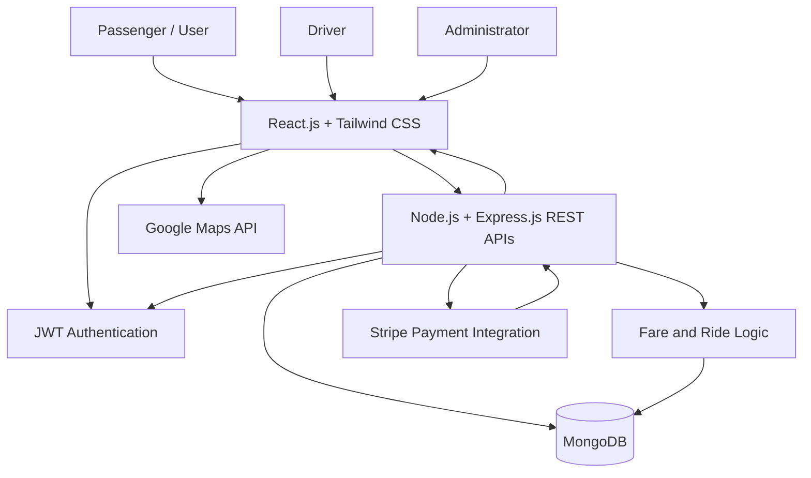
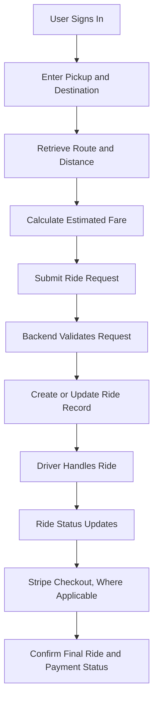

🚗 TransportX --- User Ride Booking Platform

<strong>{=html}A full-stack ride-booking platform connecting
passengers, drivers, and administrators through location-aware
navigation and secure online payments.</strong>{=html}

{=html}
{=html}
{=html}
{=html}
{=html}
{=html}

<a href="https://transport-cmoh.vercel.app/">{=html}🌐 Live Demo</a>{=html}

📌 Overview
TransportX is a full-stack ride-booking platform designed to
streamline the ride experience for passengers, drivers, and
administrators. The application combines a responsive React.js interface
with a Node.js and Express.js backend, MongoDB data storage, Google
Maps-powered location features, JWT-based authentication, and Stripe
payment processing.
The platform is organized around three role-based experiences: User,
Driver, and Admin. Google Maps features support location
tracking, route estimation, and navigation, while fare calculation and
checkout help provide a smooth booking flow.

✨ Key Features

👤 Authentication & Role-Based Access
- JWT-based authentication for secure session workflows.
- Role-based access control for User, Driver, and Admin dashboards.
- Protected backend routes for role-specific operations.
- 
🚕 Ride Booking
- Ride request and booking workflows.
- Pickup and destination selection.
- Ride status and booking information displayed through the
  application.
  
🗺️ Maps, Routes & Navigation
- Google Maps API integration for map and location features.
- GPS-based location tracking where device permissions and services
  are available.
- Route estimation and navigation support.
- Dynamic fare calculation based on the pricing logic implemented by
  the application.
  
💳 Online Payments
- Stripe integration for online checkout.
- Backend APIs to create and manage payment-related requests.
- Payment status handling based on the configured Stripe workflow.
- 
🧑‍✈️ Driver Dashboard
- Driver-specific interface for ride-related tasks.
- Ride status updates and location-related functionality, depending on
  the enabled application features.
  
🛠️ Admin Dashboard
- Role-specific administrative interface.
- Centralized access to platform operations supported by the
  implementation.
  
📱 Responsive User Interface
- React.js frontend styled with Tailwind CSS.
- Layouts designed for desktop and mobile screen sizes.
- RESTful API communication between frontend and backend.
- 
🧰 Technology Stack

  Technology                          Purpose
  
  ⚛️ React.js                        Frontend interface and dashboards
  
  🎨 Tailwind CSS                    Responsive styling and UI components
  
  🟢 Node.js                         Backend JavaScript runtime
  
  🚀 Express.js                      REST API framework
  
  🍃 MongoDB                         Application data storage
  
  🔐 JWT                             Authentication and protected routes
  
  🗺️ Google Maps API                 Maps, routes, location tracking, and navigation
  
  💳 Stripe                          Online payment processing
  
  🔧 Git & GitHub                    Version control and collaboration
  
🏗️ System Architecture

🔄 Ride Booking Workflow

Note: The diagrams describe the platform's high-level workflow.
Adjust them if your implementation uses a different order for driver
assignment, ride completion, or payment collection.

📁 Example Project Structure
Your repository already contains client/ and server/ folders. The
internal structure below is illustrative; update filenames to match your
code.
Transport/
├── client/                 # React.js frontend
│   ├── src/
│   ├── public/
│   └── package.json
├── server/                 # Node.js and Express.js backend
│   ├── routes/
│   ├── controllers/
│   ├── models/
│   ├── middleware/
│   └── package.json
├── README.md
└── .gitignore

🚀 Getting Started
Prerequisites
- Node.js and npm
- MongoDB local instance or hosted database
- Google Maps API key with the required APIs enabled
- Stripe account and test API credentials
  
1. Clone the repository
git clone https://github.com/Mohitkr09/Transport.git
cd Transport

3. Configure the backend
cd server
npm install
Create a .env file in the backend directory. The names below are
examples; use the variable names expected by your application.
PORT=5000
MONGODB_URI=your_mongodb_connection_string
JWT_SECRET=replace_with_a_strong_secret
STRIPE_SECRET_KEY=your_stripe_test_secret_key
Add any additional configuration required by your backend. Never commit
real secrets or production keys.
Start the backend using the script configured in server/package.json.
For example:
npm run dev
If your project does not define a dev script, use the appropriate
script listed in package.json.

5. Configure the frontend
Open another terminal:
cd client
npm install
Configure the frontend API base URL and Google Maps key using the
environment-variable names referenced by your code. For example, a Vite
project might use:
VITE_API_URL=http://localhost:5000
VITE_GOOGLE_MAPS_API_KEY=your_google_maps_api_key
If the frontend uses Create React App or another build tool, use that
tool's expected variable prefix instead.
Start the frontend:
npm run dev
Use npm start instead if that is the script defined by your frontend's
package.json.

7. Configure Stripe and Google Maps
- Use Stripe test mode while developing.
- Keep Stripe secret keys on the server only.
- Configure Google Maps API restrictions for the required APIs and
  websites.
- Verify payment results on the backend and handle failed or canceled
  payments.
- Configure CORS to allow requests from the frontend origin.
  
🔐 Security Best Practices
- Store secrets in environment variables and exclude .env files from
  Git.
- Verify JWTs on protected backend routes.
- Enforce role permissions on the server, not only by hiding frontend
  pages.
- Validate pickup, destination, fare, and ride-status data on the
  backend.
- Never trust a client-supplied fare or payment-success status without
  server-side validation.
- Use Stripe's recommended payment flow and verify payment events
  where applicable.
- Restrict API keys and enable appropriate production HTTPS settings.

🧪 Suggested Testing Checklist
- [ ] User, Driver, and Admin login and role permissions.
- [ ] Protected API routes reject unauthorized requests.
- [ ] Pickup and destination selection work correctly.
- [ ] Maps and route estimation load successfully.
- [ ] Fare calculations handle valid and invalid inputs.
- [ ] Ride creation and ride-status updates work correctly.
- [ ] Stripe test payments handle success, cancellation, and failure.
- [ ] Frontend handles network errors and loading states.
- [ ] Responsive layouts work on mobile and desktop.
      
🔮 Future Enhancements
- Live driver-to-user location updates with WebSockets.
- Estimated arrival times and ride history analytics.
- Ratings and reviews for drivers and passengers.
- Push notifications for ride status changes.
- Automated end-to-end testing and CI/CD workflows.
  
👨‍💻 Author
Mohit Kumar
GitHub: @Mohitkr09

📄 License
Add a LICENSE file if you want to define how others may use, modify,
and distribute this project.
